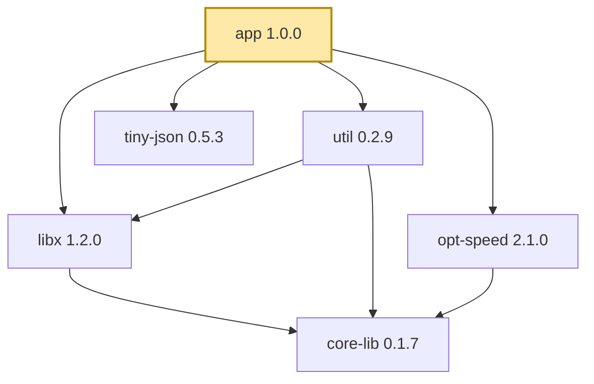
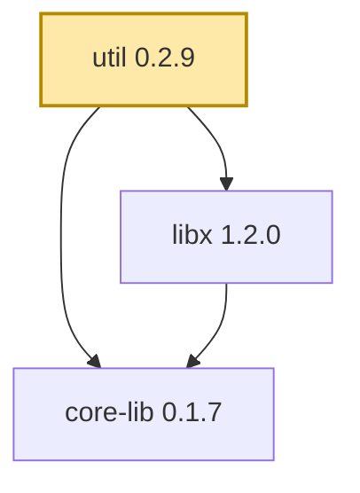
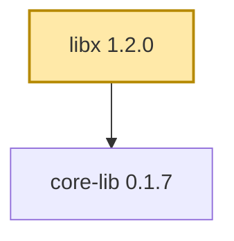
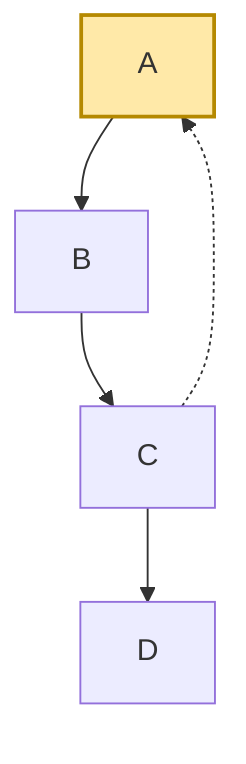

# Визуализатор графа зависимостей Cargo

Учебный проект по дисциплине «Конфигурационное управление».
Вариант №16. Инструмент строит граф зависимостей пакетов Rust (Cargo).
Язык — Python 3.10+, сторонние библиотеки не используются.

## Возможности и структура

Запуск: `python src\depgraph.py --config КОНФИГ.yaml [--action ДЕЙСТВИЕ]`.

| `--action` | Что делает |
| --- | --- |
| `config` | печатает параметры из конфигурации (ключ: значение) |
| `direct` | прямые зависимости заданной версии пакета |
| `graph` (по умолчанию) | граф зависимостей с транзитивными (DFS, циклы, фильтр) |
| `reverse` | пакеты, которые зависят от заданного (тестовый режим) |
| `mermaid` | граф на языке Mermaid |
| `image` | то же + изображение (сохраняется и открывается) |

```text
src/
  depgraph.py        точка входа, разбор параметров, действия
  settings.py        проверка параметров конфигурации
  yaml_config.py     чтение YAML (подмножество, без библиотек)
  cargo_index.py     репозиторий Cargo (разреженный индекс), версии
  cargo_features.py  features и необязательные зависимости
  semver.py          версии и требования ^, ~, =, >=, *
  file_repo.py       тестовый репозиторий (файл с буквами)
  graph.py           граф: DFS с рекурсией, фильтр, циклы, дерево
  reverse.py         обратные зависимости
  mermaid.py         текст диаграммы Mermaid
  render.py          изображение (mermaid.ink или mmdc)
  errors.py          ошибки приложения
tests/               unit-тесты, тестовые репозитории, учебный реестр
configs/             примеры конфигураций
run*.bat             скрипты запуска и проверки каждого этапа
```

## Этап 1 — конфигурация

Параметры задаются YAML-файлом (`--config`, по умолчанию `config.yaml`):

| Ключ | Значение |
| --- | --- |
| `package` | имя анализируемого пакета |
| `repository` | URL репозитория или путь к файлу тестового репозитория |
| `test_mode` | `true` — `repository` это файл тестового репозитория |
| `version` | версия пакета, `1.2.3` |
| `filter` | подстрока: пакеты с такой подстрокой в имени не учитываются (с этапа 3) |

```yaml
package: serde
repository: https://index.crates.io
test_mode: false
version: 1.0.200
filter: ""
```

При запуске выводятся все параметры в формате `ключ: значение`.
Ошибки (нет файла, неверный YAML, неверное значение любого параметра,
лишние или пропущенные ключи) печатаются как `Ошибка: ...`, код возврата 2.

Поддерживается подмножество YAML: `ключ: значение`, комментарии `#`,
кавычки, булевы значения. Вложенные структуры и списки не нужны и
сообщаются как ошибка.

## Запуск и тесты

Из корня проекта:

```bat
run.bat
python src\depgraph.py --config configs\test_tree.yaml
run_stage1.bat
python -m unittest discover -s tests
```

`run_stage1.bat` запускает все корректные и ошибочные конфигурации
из `configs/` и `tests/configs/`.

## Этап 2 — сбор данных

Формат пакетов — Cargo (Rust). Зависимости берутся из **разреженного
индекса** реестра (`repository: https://index.crates.io`): для каждого
пакета есть текстовый файл (`se/rd/serde`), в котором строка JSON
описывает одну версию (зависимости, features, признак `yanked`). Менеджер
пакетов, `cargo` и сторонние библиотеки не используются, только HTTP
из стандартной библиотеки Python.

Для заданной версии выводятся **прямые зависимости**:

```text
> python src\depgraph.py --config configs\local_registry.yaml --action direct
Прямые зависимости app 1.0.0:
  libx 1.2.0
  util 0.2.9
  opt-speed 2.1.0
  tiny-json 0.5.3
```

Зависимости выводятся с версией, разрешённой по требованию (`^1.0`,
`~0.2.1`): берётся наибольшая не отозванная (`yanked`) версия без
пред-релиза.

Какие зависимости считаются прямыми:

- вид `normal` (без `dev` и `build`);
- без платформенных (`target = cfg(...)`);
- необязательные (`optional`) — только если их включает feature
  `default` (разбираются `dep:name`, `name/feature`, цепочки feature).

Модули: `cargo_index.py` (индекс и репозиторий), `cargo_features.py`
(features), `semver.py` (версии и требования `^`, `~`, `=`, `>=`, `*`).

Ошибки: пакет не найден, версия не найдена, репозиторий недоступен,
неверные данные индекса — `Ошибка: ...`, код 2.

### Учебный реестр без интернета

В `tests/registry` лежит маленький реестр в формате индекса crates.io
(вымышленные пакеты `app`, `libx`, `util`, ...). Его запускает
`tests/with_registry.py` (локальный сервер на порту 8000, пока работает
программа):

```bat
python tests\with_registry.py -- --config configs\local_registry.yaml
```

Команды: `--action direct` (прямые зависимости) и `--action config` (показать
параметры). Проверка: `run_stage2.bat`, тесты `python -m unittest
discover -s tests`.

## Этап 3 — граф зависимостей

`--action graph` (по умолчанию) строит граф с учётом транзитивности:

- обход **DFS с рекурсией** (`graph.build_graph`);
- пакеты, в имени которых есть подстрока `filter`, не учитываются
  (вместе с зависимостями, достижимыми только через них);
- циклы не приводят к зацикливанию: узел помечается посещённым до
  обхода потомков, найденный цикл выводится (`A -> B -> C -> A`);
- в дереве `(*)` — пакет уже показан выше, `(цикл)` — ссылка на предка;
- если корневой пакет исключён фильтром — ошибка.

```text
> python src\depgraph.py --config configs\test_cycle.yaml
Граф зависимостей A (фильтр: "")
A
└── B
    └── C
        ├── A (цикл)
        └── D
Пакетов: 4, зависимостей: 4
Циклическая зависимость: A -> B -> C -> A
```

### Тестовый режим

При `test_mode: true` параметр `repository` — путь к файлу, где пакеты
названы большими латинскими буквами:

```text
# ПАКЕТ: зависимости
A: B C
B: C
C:
```

Примеры в `tests/repos`: `tree` (дерево), `diamond` (ромб), `cycle`
(цикл), `self_cycle` (зависимость от себя), `filter` (имена BA, BB для
фильтра `B`), `disconnected` (несвязанные части), `big` (11 пакетов,
два цикла). Конфигурации для них: `configs/test_*.yaml`. Версия в
тестовом режиме не используется. Неверные файлы (`tests/repos/invalid`)
и ошибки фильтра (`tests/graph_configs`) сообщаются как `Ошибка: ...`.

Проверка: `run_stage3.bat`.

## Этап 4 — обратные зависимости

`--action reverse` выводит пакеты, **которые зависят от заданного**
(`package` в конфигурации — это пакет-цель). Используется тот же обход
DFS (`graph.build_graph`): репозиторий «переворачивается» адаптером
`reverse.ReverseRepository`, у которого зависимостями узла служат зависящие
от него пакеты. Поэтому фильтр, циклы и пометки `(*)`, `(цикл)` работают так
же, как на этапе 3.

```text
> python src\depgraph.py --config configs\reverse_diamond.yaml --action reverse
Обратные зависимости E (фильтр: "")
Каждый пакет в дереве зависит от своего родителя:
E
└── D
    ├── B
    │   └── A
    └── C
        └── A (*)
Напрямую зависят от E: D
Зависят прямо или транзитивно: A, B, C, D
```

Режим работает в **тестовом режиме** (`test_mode: true`): файл содержит весь
репозиторий. Индекс crates.io не хранит списка зависящих пакетов, поэтому для
реального реестра выводится ошибка с пояснением.

Примеры: `configs/reverse_*.yaml` (дерево, ромб, цикл, зависимость от себя,
фильтр, большой граф, пакет без потребителей), ошибки —
`tests/reverse_configs`. Проверка: `run_stage4.bat`.

## Этап 5 — визуализация

Действия:

| Команда | Что делает |
| --- | --- |
| `--action mermaid` | печатает граф на языке Mermaid |
| `--action image` | печатает Mermaid, сохраняет `output/ПАКЕТ.mmd` и `.png`, открывает изображение |

Дополнительно: `--output ФАЙЛ.png` (куда сохранить), `--no-show` (не
открывать), `--renderer ink|mmdc`. По умолчанию изображение получает
сервис [mermaid.ink](https://mermaid.ink) (нужен интернет, текст диаграммы
передаётся в адресе). `--renderer mmdc` использует локальную утилиту Mermaid CLI
(`npm i -g @mermaid-js/mermaid-cli`), интернет не нужен. Если изображение
получить не удалось, текст диаграммы всё равно сохранён в `.mmd` (его
можно открыть на https://mermaid.live). Каталог `output/` в `.gitignore`:
изображения в репозиторий не добавляются.

На диаграмме корень выделен цветом, пакеты с общими зависимостями показаны
одним узлом, ребро, замыкающее цикл, нарисовано пунктиром. Модули:
`mermaid.py` (текст), `render.py` (изображение).

### Примеры для трёх пакетов (учебный реестр)

`python tests\with_registry.py -- --config configs\registry_app.yaml --action mermaid`
(так же `registry_util.yaml`, `registry_libx.yaml`). GitHub рисует диаграммы
прямо в README.

**app 1.0.0**



**util 0.2.9**



**libx 1.2.0**



Тестовый граф с циклом (`configs/test_cycle.yaml`):



Для реальных пакетов: `configs/real_regex.yaml`, `real_rand.yaml`,
`real_clap.yaml` (нужен интернет).

### Сравнение с `cargo tree`

Штатный инструмент визуализации Cargo — `cargo tree`. Чтобы сравнить на
одних и тех же данных, `tests/cargo_compare.py` собирает из `tests/registry`
настоящий реестр Cargo (архивы `.crate` создаются во временной папке),
запускает `cargo tree` и depgraph. Результат для `app 1.0.0`
(`cargo tree -e normal`, версия cargo 1.97):

```text
depgraph                          cargo tree -e normal
app 1.0.0                         app v1.0.0
├── libx 1.2.0                    ├── libx v1.2.0
│   └── core-lib 0.1.7            │   └── core-lib v0.1.7
├── util 0.2.9                    ├── opt-speed v2.1.0
│   ├── core-lib 0.1.7 (*)        │   └── core-lib v0.1.7
│   └── libx 1.2.0 (*)            ├── tiny-json v0.5.3
├── opt-speed 2.1.0               └── util v0.2.9
│   └── core-lib 0.1.7 (*)            ├── core-lib v0.1.7
└── tiny-json 0.5.3                   └── libx v1.2.0 (*)
```

Состав пакетов и выбранные версии совпадают: `libx 1.2.0` (не отозванная
`1.2.5`, не пред-релиз `1.3.0-beta.1`, не `2.0.0`), `core-lib 0.1.7`,
`util 0.2.9`, переименованная зависимость `json` -> `tiny-json`,
`opt-speed` (включена feature `default`). Не попали в вывод ни там, ни там:
`extra` (feature `full` не включена) и `testing` (dev-зависимость).

Расхождения и их причины:

1. **Порядок.** `cargo tree` сортирует зависимости по имени, depgraph
   сохраняет порядок индекса (порядок объявления). Граф тот же.
2. **Пометка `(*)`.** Cargo ставит её только у повторяющихся пакетов, у
   которых есть собственные зависимости, depgraph — у любого повтора. Из-за
   этого `core-lib` под `util` помечен `(*)` у depgraph.
3. **Build-зависимости.** По умолчанию `cargo tree` дополнительно выводит
   раздел `[build-dependencies]` (`builder v1.0.0`), depgraph учитывает только
   обычные (`normal`) зависимости, поэтому `builder` в графе нет.
4. **Платформенные зависимости.** `winapi` (`cfg(windows)`) `cargo tree`
   показывает только для нужной платформы (на Linux — при `--target all`),
   depgraph платформенные зависимости не учитывает совсем.
5. **Формат строки.** У cargo префикс `v` и пометка источника
   (`registry local`), у depgraph — `имя версия`.

Причины расхождений: depgraph намеренно упрощён (по заданию нельзя
использовать готовые средства получения зависимостей), а Cargo считает
зависимости для конкретной сборки (платформа, features, виды зависимостей,
единый для всего дерева выбор версий).

Повторить сравнение: `python tests\cargo_compare.py app 1.0.0` (нужен
установленный cargo). Для реальных пакетов: `cargo tree -p regex@1.10.6 -e
normal` в проекте с зависимостью `regex`, и `python src\depgraph.py --config
configs\real_regex.yaml`. Реальный crates.io в этой среде недоступен, поэтому
сравнение выше выполнено на учебном реестре; для настоящих пакетов
расхождения будут из-за тех же причин (особенно features и платформенных
зависимостей).

Проверка: `run_stage5.bat`, `python -m unittest discover -s tests`.
